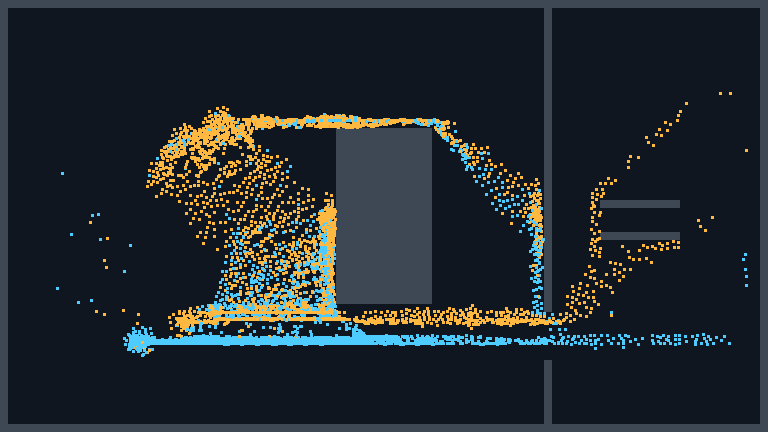
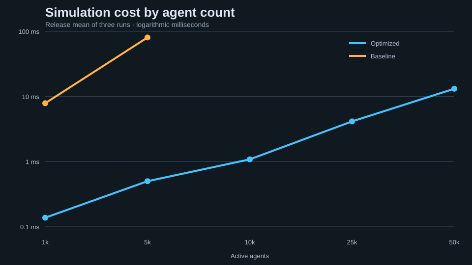
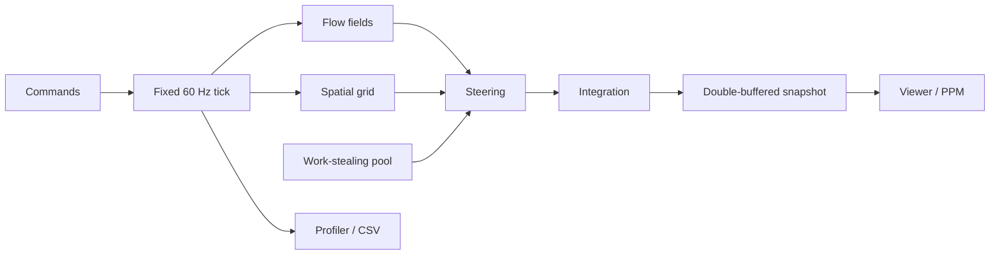

# RushGrid

A deterministic C++20 crowd simulation built to move up to **50,000 agents** through a congested transit concourse in real time.



RushGrid is a portfolio project focused on data-oriented design, parallel systems, pathfinding, deterministic simulation, and evidence-driven optimization. Agents dynamically reroute when fare gates open or close.

## Highlights

- Dense structure-of-arrays agent storage with generational handles
- Uniform spatial grid using count/prefix-sum/scatter construction
- Shared reverse-Dijkstra flow fields with dynamic gate invalidation
- Custom C++20 work-stealing pool with wait-with-help and atomic wait/notify
- Parallel steering and integration with immutable render snapshots
- Reproducible benchmark suite, scoped profiler, CSV export, and state hashing
- Retained AoS/all-pairs/per-agent-A* baseline for direct comparison

## Performance

Measured on an AMD Ryzen 5 3600 (6 cores / 12 threads), GCC 13.2, Windows:

| Configuration | Workers | Average tick | Agent updates/s |
|---|---:|---:|---:|
| Optimized, 10,000 agents | 5 | 1.083 ms | 9.23 M |
| Optimized, 50,000 agents | 5 | 13.173 ms | 3.80 M |
| Optimized, 50,000 agents | 11 | 8.810 ms | 5.68 M |
| Baseline, 5,000 agents | 0 | 80.691 ms | 62.0 K |

At 5,000 agents, the complete optimized path was **161× faster** than the baseline. Results use three Release runs with a warm-up period; see the [methodology and caveats](docs/PROFILING.md) and [raw sample data](artifacts/csv/sample.csv).



## Build and run

**Requirements:** CMake 3.24+, Ninja, and a C++20 compiler. The interactive viewer is available on Windows; the simulation, benchmark, tests, and PPM renderer have no runtime dependencies.

```powershell
cmake --preset release
cmake --build --preset release
ctest --preset release

# Interactive Windows viewer
.\build\release\rushgrid_app.exe

# Headless deterministic demo
.\build\release\rushgrid_demo.exe --agents 10000 --threads 11 --ticks 1800

# Reproducible benchmark
.\build\release\rushgrid_benchmark.exe --agents 25000 --threads 8 `
  --implementation optimized --seed 1337 --duration-seconds 30
```

Viewer controls include pause/resume, live gate editing, agent and worker scaling, baseline/optimized switching, spatial-grid and flow-field overlays, heatmaps, and profiler timelines.

## Architecture



Technical notes: [architecture](docs/ARCHITECTURE.md) · [data layout](docs/DATA_LAYOUT.md) · [job system](docs/JOB_SYSTEM.md) · [navigation](docs/NAVIGATION.md) · [profiling](docs/PROFILING.md)
