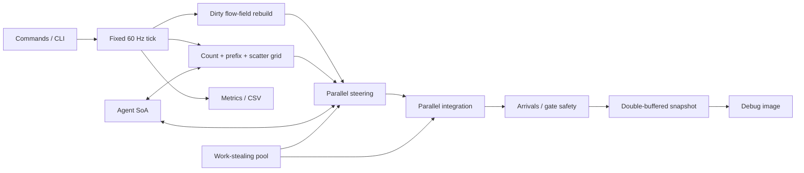

# RushGrid

RushGrid is a deterministic C++20 crowd simulation that moves up to 50,000
commuters through a congested transit concourse using dense structure-of-arrays
storage, a uniform spatial grid, shared reverse flow fields, and a custom
work-stealing job system.


## Measured result

On an AMD Ryzen 5 3600 (6 cores / 12 logical processors), GCC 13.2.0, and
Windows build 26200:

| Configuration | Workers | Average tick | p95 tick | Updates/s |
|---|---:|---:|---:|---:|
| Optimized, 10,000 agents | 5 | 1.003 ms | 1.185 ms | 9.97 M |
| Optimized, 25,000 agents | 5 | 3.418 ms | 4.241 ms | 7.32 M |
| Optimized, 50,000 agents | 5 | 10.540 ms | 11.699 ms | 4.74 M |
| Optimized, 50,000 agents | 11 | 8.666 ms | 10.605 ms | 5.77 M |
| Baseline, 5,000 agents | 0 | 89.715 ms | 109.449 ms | 55.7 K |

At 5,000 agents, the full optimized path averaged **196× faster** than the
retained AoS/all-pairs/per-agent-A* baseline. This is an end-to-end comparison:
it intentionally includes the layout, algorithm, and threading changes rather
than attributing the result to one optimization.

Each main-matrix value is the mean of three independent Release runs with a
one-second warm-up and five measured simulation seconds. The worker-scaling
capture uses three measured seconds. The raw rows are in
[`artifacts/csv/sample.csv`](artifacts/csv/sample.csv), and the complete method
and caveats are in [`docs/PROFILING.md`](docs/PROFILING.md).


## Build

Requirements:

- Windows 10/11
- CMake 3.24 or newer
- A C++20 compiler
- Ninja

```powershell
cmake --preset release
cmake --build --preset release
ctest --preset release
```

The project has no runtime or test-framework dependency. Visual output is a
portable PPM image, so the simulation and benchmark remain usable on a clean
build machine.

## Run the technical demo

```powershell
.\build\release\rushgrid_demo.exe `
  --agents 10000 `
  --threads 11 `
  --ticks 1800 `
  --barrier-tick 900 `
  --output artifacts\screenshots\rushgrid.ppm
```

The demo runs a fixed 60 Hz simulation, closes the upper fare gate at the
requested command boundary, rebuilds both flow fields, prints live system
timings, and exports the final immutable render snapshot.

Use `--implementation baseline` to run the retained slow path. The baseline is
deliberately expensive; start at 1,000 agents.

## Run a reproducible benchmark

```powershell
.\build\release\rushgrid_benchmark.exe `
  --scenario concourse `
  --agents 25000 `
  --threads 8 `
  --implementation optimized `
  --seed 1337 `
  --warmup-seconds 5 `
  --duration-seconds 30 `
  --repeat 3 `
  --output artifacts\csv\run.csv
```

`--threads 0` selects the single-threaded optimized path. Worker counts exclude
the caller, which helps execute queued work while it waits.

## Engineering highlights

- Dense, reserved SoA storage with generational handles and swap removal
- No per-agent polymorphism and no per-agent work allocation
- Contiguous count/prefix-sum/scatter spatial grid
- Cached reverse Dijkstra flow fields for shared destinations
- Dynamic gate invalidation with complete field swaps at tick boundaries
- AoS, all-pairs, individual-A* baseline kept in the same executable
- Persistent workers, worker-local deques, stealing, wait-with-help, and C++20
  atomic wait/notify
- Parallel steering and integration with disjoint output ranges
- Double-buffered immutable render snapshots
- Fixed-capacity sample windows and CSV export
- Deterministic seed, fixed step, stable ownership, and state hash

## Architecture



More detail:

- [`docs/ARCHITECTURE.md`](docs/ARCHITECTURE.md)
- [`docs/DATA_LAYOUT.md`](docs/DATA_LAYOUT.md)
- [`docs/JOB_SYSTEM.md`](docs/JOB_SYSTEM.md)
- [`docs/NAVIGATION.md`](docs/NAVIGATION.md)
- [`docs/PROFILING.md`](docs/PROFILING.md)

## Current scope

The repository delivers the simulation, benchmark, tests, deterministic dynamic
incident, debug snapshot, raw evidence, and technical documentation. A real-time
SDL/native window, editable barrier UI, detailed per-zone timeline, and
packaged Windows release remain presentation-layer work. They are intentionally
separated from the proven headless core.
