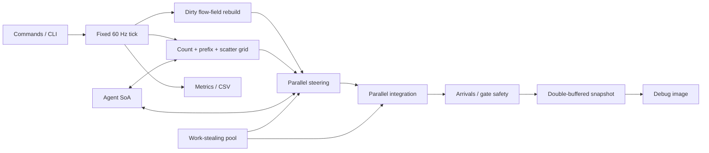

# RushGrid

RushGrid is a deterministic C++20 crowd simulation that moves up to 50,000
commuters through a congested transit concourse using dense structure-of-arrays
storage, a uniform spatial grid, shared reverse flow fields, and a custom
work-stealing job system.


## Measured result

On an AMD Ryzen 5 3600 (6 cores / 12 logical processors), GCC 13.2.0, and
Windows build 26200:

| Configuration | Workers | Average tick | p95 tick | Updates/s |
|---|---:|---:|---:|---:|
| Optimized, 10,000 agents | 5 | 1.083 ms | 1.302 ms | 9.23 M |
| Optimized, 25,000 agents | 5 | 4.148 ms | 4.784 ms | 6.03 M |
| Optimized, 50,000 agents | 5 | 13.173 ms | 14.598 ms | 3.80 M |
| Optimized, 50,000 agents | 11 | 8.810 ms | 10.472 ms | 5.68 M |
| Baseline, 5,000 agents | 0 | 80.691 ms | 100.733 ms | 62.0 K |

At 5,000 agents, the full optimized path averaged **161× faster** than the
retained AoS/all-pairs/per-agent-A* baseline. This is an end-to-end comparison:
it intentionally includes the layout, algorithm, and threading changes rather
than attributing the result to one optimization.

Each main-matrix value is the mean of three independent Release runs with a
one-second warm-up and five measured simulation seconds. The worker-scaling
capture uses three measured seconds. The raw rows are in
[`artifacts/csv/sample.csv`](artifacts/csv/sample.csv), and the complete method
and caveats are in [`docs/PROFILING.md`](docs/PROFILING.md).


## Build

Requirements:

- Windows 10/11
- CMake 3.24 or newer
- A C++20 compiler
- Ninja

```powershell
cmake --preset release
cmake --build --preset release
ctest --preset release
```

The project has no runtime or test-framework dependency. Visual output is a
portable PPM image, so the simulation and benchmark remain usable on a clean
build machine.

To create a self-contained Windows ZIP with statically linked MinGW runtimes:

```powershell
cmake --build --preset release --target package
```

The archive is written to `out/RushGrid-0.1.0-windows-x64.zip`.

## Run the interactive viewer

```powershell
.\build\release\rushgrid_app.exe
```

Controls:

| Key | Action |
|---|---|
| `Space` | Pause/resume |
| `1`, `2` | Open or close each fare gate |
| `B` | Switch baseline/optimized and reset |
| `+`, `-` | Double/halve agents (1,000–50,000) |
| `[`, `]` | Remove/add a worker and reset |
| `G` | Spatial-grid overlay |
| `H` | Occupancy heatmap |
| `F` | Goal-zero flow vectors |
| `T` | Scoped main/worker timeline |
| `R` | Reset the seeded scenario |
| `Esc` | Quit |

The native Windows viewer renders the published snapshot into a top-down DIB
backbuffer and shows live current/p50/p95/p99 tick time. Its rendering cost is
outside simulation timings.

## Run the technical demo

```powershell
.\build\release\rushgrid_demo.exe `
  --agents 10000 `
  --threads 11 `
  --ticks 1800 `
  --barrier-tick 900 `
  --output artifacts\screenshots\rushgrid.ppm
```

The demo runs a fixed 60 Hz simulation, closes the upper fare gate at the
requested command boundary, rebuilds both flow fields, prints live system
timings, and exports the final immutable render snapshot.

Use `--implementation baseline` to run the retained slow path. The baseline is
deliberately expensive; start at 1,000 agents.

## Run a reproducible benchmark

```powershell
.\build\release\rushgrid_benchmark.exe `
  --scenario concourse `
  --agents 25000 `
  --threads 8 `
  --implementation optimized `
  --seed 1337 `
  --warmup-seconds 5 `
      --duration-seconds 30 `
      --repeat 3 `
      --output artifacts\csv\run.csv
```

`--threads 0` selects the single-threaded optimized path. Worker counts exclude
the caller, which helps execute queued work while it waits.
Add `--detailed-profiling` to capture per-job timeline zones; it is disabled by
default in benchmarks so instrumentation does not silently alter comparisons.

## Engineering highlights

- Dense, reserved SoA storage with generational handles and swap removal
- No per-agent polymorphism and no per-agent work allocation
- Contiguous count/prefix-sum/scatter spatial grid
- Cached reverse Dijkstra flow fields for shared destinations
- Dynamic gate invalidation with complete field swaps at tick boundaries
- AoS, all-pairs, individual-A* baseline kept in the same executable
- Persistent workers, worker-local deques, stealing, wait-with-help, and C++20
  atomic wait/notify
- Parallel steering and integration with disjoint output ranges
- Double-buffered immutable render snapshots
- Fixed-capacity sample windows and CSV export
- Preallocated scoped profiler with per-worker timeline events
- Deterministic seed, fixed step, stable ownership, and state hash

## Architecture



More detail:

- [`docs/ARCHITECTURE.md`](docs/ARCHITECTURE.md)
- [`docs/DATA_LAYOUT.md`](docs/DATA_LAYOUT.md)
- [`docs/JOB_SYSTEM.md`](docs/JOB_SYSTEM.md)
- [`docs/NAVIGATION.md`](docs/NAVIGATION.md)
- [`docs/PROFILING.md`](docs/PROFILING.md)

## Current scope

The repository delivers the simulation, interactive Windows viewer, benchmark,
tests, deterministic gate editing, overlays, debug snapshot, raw evidence, and
technical documentation, scoped worker timeline, and self-contained Windows
package. Arbitrary barrier painting and a graphical scenario editor remain
presentation work.
