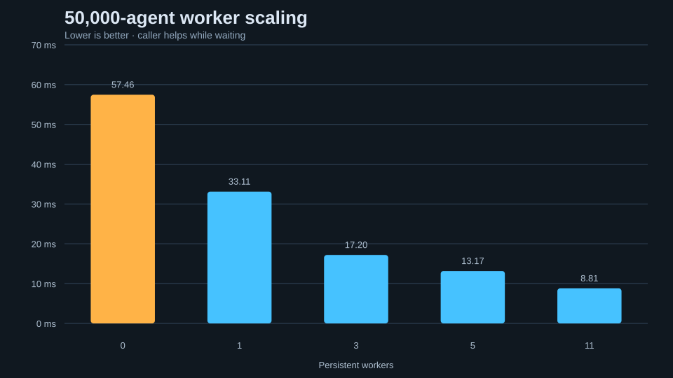

# Profiling and reproduction

## Checked-in capture

Date: 2026-07-24

- CPU: AMD Ryzen 5 3600, 6 cores / 12 logical processors
- OS: Microsoft Windows build 26200
- Compiler: GCC 13.2.0
- Build: `-O3 -DNDEBUG`, CMake Release preset
- Scenario: `concourse`
- Seed: 1337
- Fixed step: 60 Hz
- Optimized main matrix: 5 workers
- Warm-up: 60 ticks
- Capture: 300 ticks
- Repeats: 3 independent simulations

The benchmark closes the upper gate halfway through each measured capture. That
tick includes both flow-field rebuilds instead of hiding dynamic navigation
cost outside the reported total.

| Agents | Implementation | Workers | Mean average | Mean p95 |
|---:|---|---:|---:|---:|
| 1,000 | optimized | 5 | 0.138 ms | 0.174 ms |
| 5,000 | optimized | 5 | 0.500 ms | 0.603 ms |
| 10,000 | optimized | 5 | 1.083 ms | 1.302 ms |
| 25,000 | optimized | 5 | 4.148 ms | 4.784 ms |
| 50,000 | optimized | 5 | 13.173 ms | 14.598 ms |
| 1,000 | baseline | 0 | 7.888 ms | 11.829 ms |
| 5,000 | baseline | 0 | 80.691 ms | 100.733 ms |

No result is extrapolated. Larger baseline counts were not included in the
five-second repeated capture because all-pairs work makes them intentionally
slow.

## Worker scaling at 50,000 agents

The scaling rows use 180 measured ticks and three repeats:

| Workers | Effective participants | Mean tick | Speedup vs 0 |
|---:|---:|---:|---:|
| 0 | caller only | 57.458 ms | 1.00× |
| 1 | caller + 1 worker | 33.112 ms | 1.74× |
| 3 | caller + 3 workers | 17.196 ms | 3.34× |
| 5 | caller + 5 workers | 13.173 ms | 4.36× |
| 11 | caller + 11 workers | 8.810 ms | 6.52× |



## Reproduce the long-form matrix

```powershell
cmake --preset release
cmake --build --preset release

$counts = 1000, 5000, 10000, 25000, 50000
foreach ($count in $counts) {
    .\build\release\rushgrid_benchmark.exe `
      --scenario concourse `
      --agents $count `
      --threads 11 `
      --implementation optimized `
      --seed 1337 `
      --warmup-seconds 5 `
      --duration-seconds 30 `
      --repeat 3 `
      --output artifacts\csv\long_matrix.csv
}
```

Use a quiet machine and avoid running configurations concurrently. Raw rows
contain average, p50, p95, p99, minimum, maximum, per-system averages, updates
per second, arrivals, reserved bytes, and final state hash.

## Live scoped profiler

Each tick writes timestamped zones into the unpublished half of a 4,096-event
buffer. Main-thread zones cover navigation, grid build, steering, integration,
arrivals, and snapshot publication. Every parallel chunk records its own
steering or integration zone and thread lane. Completion publishes the buffer
with release/acquire ordering; the viewer's `T` overlay consumes only that
immutable frame. Overflow increments a dropped-event counter instead of
allocating.

Detailed zones are enabled in the interactive viewer and disabled by default in
the headless benchmark. Pass `--detailed-profiling` to measure their overhead
on the same scenario and hardware. Coarse `TickMetrics` and CSV system timings
remain active in either mode, and every CSV row records the profiling mode.
In the checked-in paired 50,000-agent, five-worker capture, detailed profiling
changed mean tick time from 13.173 ms to 13.257 ms (+0.64%); mean p95 was
14.598 ms without zones and 14.581 ms with zones, which is within run noise.

## Interpretation limits

- The checked-in capture is short enough for repository verification, not a
  substitute for a dedicated lab run.
- Process RSS and total allocator activity are not measured.
- Profiler timestamps are wall-clock CPU zones, not hardware performance counters.
- Baseline and optimized floating-point trajectories are not expected to match;
  determinism is checked within an implementation across worker counts.
- Worker counts include persistent workers only; the waiting caller also helps.
- Results describe this named hardware and compiler only.
